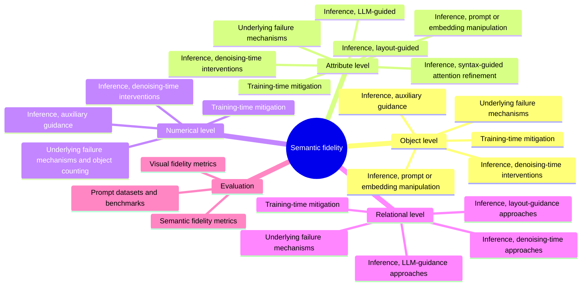

<h1 align="center">Semantic Fidelity in Text-to-Image Diffusion Models</h1>

<p align="center">
  <a href="https://awesome.re"></a>
  <a href="https://username.github.io/Awesome-Semantic-Fidelity-T2I/"></a>
  
  <a href="https://github.com/USERNAME/Awesome-Semantic-Fidelity-T2I/stargazers"></a>
  <a href="https://github.com/USERNAME/Awesome-Semantic-Fidelity-T2I/pulls"></a>
</p>

This repository collects the 189 papers reviewed in our survey **“Semantic Fidelity Challenges in Diffusion-Based Text-to-Image Models: A Survey”** by Saket Pandey, Pranav Singh Chib and Pravendra Singh (IIT Roorkee). Papers are grouped by the survey’s taxonomy, and every entry links to the paper and, where available, its code.

**[Browse and search the list on the website](https://username.github.io/Awesome-Semantic-Fidelity-T2I/)**, with filters by fidelity level, approach and year.

> If this list helps your work, please ⭐ star the repository and [cite the survey](#citation). Missing a paper? [Open an issue or a pull request](CONTRIBUTING.md).

## The four levels of semantic fidelity

Take the prompt *“Two red cubes to the left of a cat”*. A model can get it wrong in four ways:

| Level | Prompt words at stake | Typical failure | Papers |
|---|---|---|---|
| [Object](#object) | *cubes, cat* | The cat never appears. | 28 |
| [Attribute](#attribute) | *red* | The cubes come out blue. | 33 |
| [Numerical](#numerical) | *two* | Three cubes instead of two. | 33 |
| [Relational](#relational) | *to the left of* | The cubes end up on the right. | 32 |

## Taxonomy



## Contents

- [Related Surveys](#surveys)
- [Foundations](#foundations)
  - [Generative models & diffusion](#s-2-1)
  - [Attention & conditioning mechanisms](#s-2-2)
  - [Latent-space diffusion](#s-2-3)
  - [Evolution of text-to-image models](#s-2-4)
  - [State-of-the-art foundation models](#s-2-5)
- [Object-Level Fidelity](#object)
  - [Underlying failure mechanisms](#s-5-2)
  - [Training-time mitigation](#s-5-3)
  - [Inference: denoising-time interventions](#s-5-4-1)
  - [Inference: auxiliary guidance](#s-5-4-2)
  - [Inference: prompt / embedding manipulation](#s-5-4-3)
- [Attribute-Level Fidelity](#attribute)
  - [Underlying failure mechanisms](#s-6-2)
  - [Training-time mitigation](#s-6-3)
  - [Inference: denoising-time interventions](#s-6-4-1)
  - [Inference: syntax-guided attention refinement](#s-6-4-2)
  - [Inference: prompt / embedding manipulation](#s-6-4-3)
  - [Inference: layout-guided](#s-6-4-4)
  - [Inference: LLM-guided](#s-6-4-5)
- [Numerical-Level Fidelity](#numerical)
  - [Underlying failure mechanisms & object counting](#s-7-2)
  - [Training-time mitigation](#s-7-3)
  - [Inference: denoising-time interventions](#s-7-4-1)
  - [Inference: auxiliary guidance](#s-7-4-2)
- [Relational-Level Fidelity](#relational)
  - [Underlying failure mechanisms](#s-8-2)
  - [Training-time mitigation](#s-8-3)
  - [Inference: denoising-time approaches](#s-8-4-1)
  - [Inference: layout-guidance approaches](#s-8-4-2)
  - [Inference: LLM-guidance approaches](#s-8-4-3)
- [Evaluation Metrics](#metrics)
  - [Visual fidelity metrics](#s-9-1)
  - [Semantic fidelity metrics](#s-9-2)
- [Prompt Datasets & Benchmarks](#datasets)
  - [Image-caption datasets](#s-10-1)
  - [Missing-object & attribute-binding datasets](#s-10-2)
  - [Spatial & numerical reasoning datasets](#s-10-3)
  - [Overall compositionality benchmarks](#s-10-4)
- [Beyond the Four Levels](#beyond)
- [Citation](#citation)

<a id="surveys"></a>

## 📚 Related Surveys

Earlier surveys on diffusion models, quality assessment and controllable generation.

| Ref | Method | Paper | Venue | Links |
|:-:|---|---|---|---|
| [31] |  | [Diffusion Models: A Comprehensive Survey of Methods and Applications](https://arxiv.org/abs/2209.00796) <br><sub>L. Yang et al.</sub> | ACM CSUR 2023 | [arXiv](https://arxiv.org/abs/2209.00796) |
| [32] |  | [A Survey on Generative Diffusion Models](https://arxiv.org/abs/2209.02646) <br><sub>H. Cao et al.</sub> | TKDE 2024 | [arXiv](https://arxiv.org/abs/2209.02646) |
| [33] |  | [Comprehensive Exploration of Diffusion Models in Image Generation: A Survey](https://link.springer.com/article/10.1007/s10462-025-11110-3) <br><sub>H. Chen et al.</sub> | AI Review 2025 | [Springer](https://link.springer.com/article/10.1007/s10462-025-11110-3) |
| [34] |  | [Diffusion Models in Vision: A Survey](https://arxiv.org/abs/2209.04747) <br><sub>F.-A. Croitoru et al.</sub> | TPAMI 2023 | [arXiv](https://arxiv.org/abs/2209.04747) |
| [35] |  | [Diffusion Models in Low-Level Vision: A Survey](https://arxiv.org/abs/2406.11138) <br><sub>C. He et al.</sub> | TPAMI 2025 | [arXiv](https://arxiv.org/abs/2406.11138) |
| [36] |  | [Quality Assessment for Text-to-Image Generation: A Survey](https://scholars.cityu.edu.hk/en/publications/quality-assessment-for-text-to-image-generation-a-survey/) <br><sub>Y. Tian et al.</sub> | IEEE MultiMedia 2025 | [Paper](https://scholars.cityu.edu.hk/en/publications/quality-assessment-for-text-to-image-generation-a-survey/) |
| [37] |  | [A Survey of Multimodal Controllable Diffusion Models](https://doi.org/10.1007/s11390-024-3814-0) <br><sub>R. Jiang et al.</sub> | JCST 2024 | [DOI](https://doi.org/10.1007/s11390-024-3814-0) |

<p align="right"><a href="#contents">back to top</a></p>

<a id="foundations"></a>

## 🧱 Foundations (§2)

Diffusion, attention and conditioning, latent diffusion and the text-to-image models the survey builds on.

<a id="s-2-1"></a>

### Generative models & diffusion (§2.1)

| Ref | Method | Paper | Venue | Links |
|:-:|---|---|---|---|
| [1] |  | [Generative Adversarial Nets](https://proceedings.neurips.cc/paper/5423-generative-adversarial-nets) <br><sub>I. J. Goodfellow et al.</sub> | NeurIPS 2014 | [NeurIPS](https://proceedings.neurips.cc/paper/5423-generative-adversarial-nets) |
| [2] |  | [Auto-Encoding Variational Bayes](https://arxiv.org/abs/1312.6114) <br><sub>D. P. Kingma et al.</sub> | arXiv 2013 | [arXiv](https://arxiv.org/abs/1312.6114) |
| [3] | **DDPM** | [Denoising Diffusion Probabilistic Models](https://arxiv.org/abs/2006.11239) <br><sub>J. Ho et al.</sub> | NeurIPS 2020 | [arXiv](https://arxiv.org/abs/2006.11239) |
| [4] | **Improved DDPM** | [Improved Denoising Diffusion Probabilistic Models](https://arxiv.org/abs/2102.09672) <br><sub>A. Q. Nichol et al.</sub> | ICML 2021 | [arXiv](https://arxiv.org/abs/2102.09672) |

<a id="s-2-2"></a>

### Attention & conditioning mechanisms (§2.2)

| Ref | Method | Paper | Venue | Links |
|:-:|---|---|---|---|
| [6] | **CLIP** | [Learning Transferable Visual Models from Natural Language Supervision](https://arxiv.org/abs/2103.00020) <br><sub>A. Radford et al.</sub> | ICML 2021 | [arXiv](https://arxiv.org/abs/2103.00020) |
| [7] | **ControlNet** | [Adding Conditional Control to Text-to-Image Diffusion Models](https://arxiv.org/abs/2302.05543) <br><sub>L. Zhang et al.</sub> | ICCV 2023 | [arXiv](https://arxiv.org/abs/2302.05543) |
| [38] |  | [Towards Understanding Cross and Self-Attention in Stable Diffusion for Text-Guided Image Editing](https://arxiv.org/abs/2403.03431) <br><sub>B. Liu et al.</sub> | CVPR 2024 | [arXiv](https://arxiv.org/abs/2403.03431) |
| [40] | **Transformer** | [Attention Is All You Need](https://arxiv.org/abs/1706.03762) <br><sub>A. Vaswani et al.</sub> | NeurIPS 2017 | [arXiv](https://arxiv.org/abs/1706.03762) |
| [41] | **Prompt-to-Prompt** | [Prompt-to-Prompt Image Editing with Cross-Attention Control](https://openreview.net/forum?id=_CDixzkzeyb) <br><sub>A. Hertz et al.</sub> | ICLR 2023 | [OpenReview](https://openreview.net/forum?id=_CDixzkzeyb) |
| [42] |  | [When Are Lemons Purple? The Concept Association Bias of Vision-Language Models](https://aclanthology.org/2023.emnlp-main.886/) <br><sub>Y. Tang et al.</sub> | EMNLP 2023 | [ACL](https://aclanthology.org/2023.emnlp-main.886/) |
| [43] | **ARO** | [When and Why Vision-Language Models Behave Like Bags-of-Words, and What to Do About It?](https://openreview.net/forum?id=KRLUvxh8uaX) <br><sub>M. Yuksekgonul et al.</sub> | ICLR 2023 | [OpenReview](https://openreview.net/forum?id=KRLUvxh8uaX) |
| [44] | **eDiff-I** | [eDiff-I: Text-to-Image Diffusion Models with an Ensemble of Expert Denoisers](https://arxiv.org/abs/2211.01324) <br><sub>Y. Balaji et al.</sub> | arXiv 2022 | [arXiv](https://arxiv.org/abs/2211.01324) |
| [45] |  | [Towards Understanding the Working Mechanism of Text-to-Image Diffusion Model](https://openreview.net/forum?id=zTu0QEpvtZ) <br><sub>M. Yi et al.</sub> | NeurIPS 2024 | [OpenReview](https://openreview.net/forum?id=zTu0QEpvtZ) |
| [46] | **ControlNet++** | [ControlNet++: Improving Conditional Controls with Efficient Consistency Feedback](https://arxiv.org/abs/2404.07987) <br><sub>M. Li et al.</sub> | ECCV 2024 | [arXiv](https://arxiv.org/abs/2404.07987) |

<a id="s-2-3"></a>

### Latent-space diffusion (§2.3)

| Ref | Method | Paper | Venue | Links |
|:-:|---|---|---|---|
| [47] | **LAION-5B** | [LAION-5B: An Open Large-Scale Dataset for Training Next Generation Image-Text Models](https://arxiv.org/abs/2210.08402) <br><sub>C. Schuhmann et al.</sub> | NeurIPS 2022 | [arXiv](https://arxiv.org/abs/2210.08402) |

<a id="s-2-4"></a>

### Evolution of text-to-image models (§2.4)

| Ref | Method | Paper | Venue | Links |
|:-:|---|---|---|---|
| [5] | **Stable Diffusion (LDM)** | [High-Resolution Image Synthesis with Latent Diffusion Models](https://arxiv.org/abs/2112.10752) <br><sub>R. Rombach et al.</sub> | CVPR 2022 | [arXiv](https://arxiv.org/abs/2112.10752) |
| [8] | **GLIDE** | [GLIDE: Towards Photorealistic Image Generation and Editing with Text-Guided Diffusion Models](https://arxiv.org/abs/2112.10741) <br><sub>A. Nichol et al.</sub> | arXiv 2021 | [arXiv](https://arxiv.org/abs/2112.10741) |
| [9] | **DALL·E 2** | [Hierarchical Text-Conditional Image Generation with CLIP Latents](https://arxiv.org/abs/2204.06125) <br><sub>A. Ramesh et al.</sub> | arXiv 2022 | [arXiv](https://arxiv.org/abs/2204.06125) |
| [10] | **Imagen** | [Photorealistic Text-to-Image Diffusion Models with Deep Language Understanding](https://arxiv.org/abs/2205.11487) <br><sub>C. Saharia et al.</sub> | NeurIPS 2022 | [arXiv](https://arxiv.org/abs/2205.11487) |
| [48] | **DALL·E** | [Zero-Shot Text-to-Image Generation](https://arxiv.org/abs/2102.12092) <br><sub>A. Ramesh et al.</sub> | ICML 2021 | [arXiv](https://arxiv.org/abs/2102.12092) |
| [49] | **Parti** | [Scaling Autoregressive Models for Content-Rich Text-to-Image Generation](https://arxiv.org/abs/2206.10789) <br><sub>J. Yu et al.</sub> | arXiv 2022 | [arXiv](https://arxiv.org/abs/2206.10789) |

<a id="s-2-5"></a>

### State-of-the-art foundation models (§2.5)

| Ref | Method | Paper | Venue | Links |
|:-:|---|---|---|---|
| [50] | **DiT** | [Scalable Diffusion Models with Transformers](https://arxiv.org/abs/2212.09748) <br><sub>W. Peebles et al.</sub> | ICCV 2023 | [arXiv](https://arxiv.org/abs/2212.09748) |
| [51] | **PixArt-α** | [PixArt-α: Fast Training of Diffusion Transformer for Photorealistic Text-to-Image Synthesis](https://openreview.net/forum?id=eAKmQPe3m1) <br><sub>J. Chen et al.</sub> | ICLR 2024 | [OpenReview](https://openreview.net/forum?id=eAKmQPe3m1) |
| [52] | **SDXL** | [SDXL: Improving Latent Diffusion Models for High-Resolution Image Synthesis](https://openreview.net/forum?id=di52zR8xgf) <br><sub>D. Podell et al.</sub> | ICLR 2024 | [OpenReview](https://openreview.net/forum?id=di52zR8xgf) |
| [53] | **DALL·E 3** | [Improving Image Generation with Better Captions](https://cdn.openai.com/papers/dall-e-3.pdf) <br><sub>J. Betker et al.</sub> | OpenAI Tech. Report 2023 | [PDF](https://cdn.openai.com/papers/dall-e-3.pdf) |
| [54] | **Stable Diffusion 3** | [Scaling Rectified Flow Transformers for High-Resolution Image Synthesis](https://arxiv.org/abs/2403.03206) <br><sub>P. Esser et al.</sub> | ICML 2024 | [arXiv](https://arxiv.org/abs/2403.03206) |
| [55] | **FLUX** | [Demystifying FLUX Architecture](https://arxiv.org/abs/2507.09595) <br><sub>O. Greenberg</sub> | arXiv 2025 | [arXiv](https://arxiv.org/abs/2507.09595) |

<p align="right"><a href="#contents">back to top</a></p>

<a id="object"></a>

## 🧩 Object-Level Fidelity (§5)

Every entity named in the prompt should appear in the image.

<a id="s-5-3"></a>

### Training-time mitigation (§5.3)

| Ref | Method | Paper | Venue | Links |
|:-:|---|---|---|---|
| [21] | **CoMat** | [CoMat: Aligning Text-to-Image Diffusion Model with Image-to-Text Concept Matching](https://openreview.net/forum?id=OW1ldvMNJ6) <br><sub>D. Jiang et al.</sub> | NeurIPS 2024 | [OpenReview](https://openreview.net/forum?id=OW1ldvMNJ6) |
| [22] | **VersaT2I** | [VersaT2I: Improving Text-to-Image Models with Versatile Reward](https://arxiv.org/abs/2403.18493) <br><sub>J. Guo et al.</sub> | arXiv 2024 | [arXiv](https://arxiv.org/abs/2403.18493) |
| [63] | **LoRA** | [LoRA: Low-Rank Adaptation of Large Language Models](https://openreview.net/forum?id=nZeVKeeFYf9) <br><sub>E. J. Hu et al.</sub> | ICLR 2022 | [OpenReview](https://openreview.net/forum?id=nZeVKeeFYf9) |
| [64] | **ImageReward** | [ImageReward: Learning and Evaluating Human Preferences for Text-to-Image Generation](https://arxiv.org/abs/2304.05977) <br><sub>J. Xu et al.</sub> | NeurIPS 2023 | [arXiv](https://arxiv.org/abs/2304.05977) |
| [65] | **Parrot** | [Parrot: Pareto-Optimal Multi-Reward Reinforcement Learning Framework for Text-to-Image Generation](https://arxiv.org/abs/2401.05675) <br><sub>S. H. Lee et al.</sub> | ECCV 2024 | [arXiv](https://arxiv.org/abs/2401.05675) |

<a id="s-5-4-1"></a>

### Inference: denoising-time interventions (§5.4.1)

| Ref | Method | Paper | Venue | Links |
|:-:|---|---|---|---|
| [11] | **Attend-and-Excite** | [Attend-and-Excite: Attention-Based Semantic Guidance for Text-to-Image Diffusion Models](https://arxiv.org/abs/2301.13826) <br><sub>H. Chefer et al.</sub> | SIGGRAPH (ACM TOG) 2023 | [arXiv](https://arxiv.org/abs/2301.13826) [Project](https://yuval-alaluf.github.io/Attend-and-Excite/) |
| [15] | **A-STAR** | [A-STAR: Test-Time Attention Segregation and Retention for Text-to-Image Synthesis](https://arxiv.org/abs/2306.14544) <br><sub>A. Agarwal et al.</sub> | ICCV 2023 | [arXiv](https://arxiv.org/abs/2306.14544) |
| [16] |  | [Attention Overlap Is Responsible for the Entity Missing Problem in Text-to-Image Diffusion Models!](https://openreview.net/forum?id=Xv3ZrFayIO) <br><sub>A. M. Oriyad et al.</sub> | TMLR 2025 | [OpenReview](https://openreview.net/forum?id=Xv3ZrFayIO) |
| [20] | **Divide-and-Bind** | [Divide & Bind Your Attention for Improved Generative Semantic Nursing](https://arxiv.org/abs/2307.10864) <br><sub>Y. Li et al.</sub> | BMVC 2023 | [arXiv](https://arxiv.org/abs/2307.10864) |
| [39] |  | [Self-Cross Diffusion Guidance for Text-to-Image Synthesis of Similar Subjects](https://arxiv.org/abs/2411.18936) <br><sub>W. Qiu et al.</sub> | CVPR 2025 | [arXiv](https://arxiv.org/abs/2411.18936) [Code](https://github.com/mengtang-lab/selfcross-guidance) |
| [61] | **Attention Regulation** | [Enhancing Semantic Fidelity in Text-to-Image Synthesis: Attention Regulation in Diffusion Models](https://doi.org/10.1007/978-3-031-73016-0_5) <br><sub>Y. Zhang et al.</sub> | ECCV 2024 | [DOI](https://doi.org/10.1007/978-3-031-73016-0_5) |
| [66] | **Predicated Diffusion** | [Predicated Diffusion: Predicate Logic-Based Attention Guidance for Text-to-Image Diffusion Models](https://arxiv.org/abs/2311.16117) <br><sub>K. Sueyoshi et al.</sub> | CVPR 2024 | [arXiv](https://arxiv.org/abs/2311.16117) |
| [67] | **InitNO** | [InitNO: Boosting Text-to-Image Diffusion Models via Initial Noise Optimization](https://arxiv.org/abs/2404.04650) <br><sub>X. Guo et al.</sub> | CVPR 2024 | [arXiv](https://arxiv.org/abs/2404.04650) [Project](https://xiefan-guo.github.io/initno) |
| [68] | **CoCoNO** | [CoCoNO: Attention Contrast-and-Complete for Initial Noise Optimization in Text-to-Image Synthesis](https://doi.org/10.1145/3746027.3755169) <br><sub>A. K. Sundaram et al.</sub> | ACM MM 2025 | [DOI](https://doi.org/10.1145/3746027.3755169) |
| [75] | **ReNO** | [ReNO: Enhancing One-Step Text-to-Image Models Through Reward-Based Noise Optimization](https://arxiv.org/abs/2406.04312) <br><sub>L. Eyring et al.</sub> | NeurIPS 2024 | [arXiv](https://arxiv.org/abs/2406.04312) |
| [184] | **FOCUS** | [FOCUS: Optimal Control for Multi-Entity World Modeling in Text-to-Image Generation](https://arxiv.org/abs/2510.02315) <br><sub>E. T. Bill et al.</sub> | CVPR 2026 | [arXiv](https://arxiv.org/abs/2510.02315) [Code](https://github.com/ericbill21/focus) |

<a id="s-5-4-2"></a>

### Inference: auxiliary guidance (§5.4.2)

| Ref | Method | Paper | Venue | Links |
|:-:|---|---|---|---|
| [56] | **RPG** | [Mastering Text-to-Image Diffusion: Recaptioning, Planning, and Generating with Multimodal LLMs](https://arxiv.org/abs/2401.11708) <br><sub>L. Yang et al.</sub> | ICML 2024 | [arXiv](https://arxiv.org/abs/2401.11708) |
| [69] | **BoxDiff** | [BoxDiff: Text-to-Image Synthesis with Training-Free Box-Constrained Diffusion](https://arxiv.org/abs/2307.10816) <br><sub>J. Xie et al.</sub> | ICCV 2023 | [arXiv](https://arxiv.org/abs/2307.10816) |
| [70] |  | [Obtaining Favorable Layouts for Multiple Object Generation](https://arxiv.org/abs/2405.00791) <br><sub>B. Battash et al.</sub> | arXiv 2024 | [arXiv](https://arxiv.org/abs/2405.00791) |
| [71] | **Attention Refocusing** | [Grounded Text-to-Image Synthesis with Attention Refocusing](https://arxiv.org/abs/2306.05427) <br><sub>Q. Phung et al.</sub> | CVPR 2024 | [arXiv](https://arxiv.org/abs/2306.05427) |
| [72] | **B2B** | [Box It to Bind It: Unified Layout Control and Attribute Binding in T2I Diffusion Models](https://arxiv.org/abs/2402.17910) <br><sub>A. Taghipour et al.</sub> | arXiv 2024 | [arXiv](https://arxiv.org/abs/2402.17910) |
| [73] | **Multimodal-CoT** | [Multimodal Chain-of-Thought Reasoning in Language Models](https://openreview.net/forum?id=gDlsMWost9) <br><sub>Z. Zhang et al.</sub> | TMLR 2024 | [OpenReview](https://openreview.net/forum?id=gDlsMWost9) |

<a id="s-5-4-3"></a>

### Inference: prompt / embedding manipulation (§5.4.3)

| Ref | Method | Paper | Venue | Links |
|:-:|---|---|---|---|
| [17] | **TEBOpt** | [A Cat Is a Cat (Not a Dog!): Unraveling Information Mix-Ups in Text-to-Image Encoders Through Causal Analysis and Embedding Optimization](https://arxiv.org/abs/2410.00321) <br><sub>C.-Y. Chen et al.</sub> | NeurIPS 2024 | [arXiv](https://arxiv.org/abs/2410.00321) |
| [23] | **DOS** | [DOS: Directional Object Separation in Text Embeddings for Multi-Object Image Generation](https://arxiv.org/abs/2510.14376) <br><sub>D. Byun et al.</sub> | AAAI 2026 | [arXiv](https://arxiv.org/abs/2510.14376) |
| [62] | **LI-DiT** | [Exploring the Role of Large Language Models in Prompt Encoding for Diffusion Models](https://arxiv.org/abs/2406.11831) <br><sub>B. Ma et al.</sub> | NeurIPS 2024 | [arXiv](https://arxiv.org/abs/2406.11831) |
| [74] | **Composable Diffusion** | [Compositional Visual Generation with Composable Diffusion Models](https://arxiv.org/abs/2206.01714) <br><sub>N. Liu et al.</sub> | ECCV 2022 | [arXiv](https://arxiv.org/abs/2206.01714) |

<p align="right"><a href="#contents">back to top</a></p>

<a id="attribute"></a>

## 🎨 Attribute-Level Fidelity (§6)

Colours, textures, shapes and styles should attach to the right object.

<a id="s-6-3"></a>

### Training-time mitigation (§6.3)

| Ref | Method | Paper | Venue | Links |
|:-:|---|---|---|---|
| [59] |  | [Not Only Generative Art: Stable Diffusion for Content-Style Disentanglement in Art Analysis](https://arxiv.org/abs/2304.10278) <br><sub>Y. Wu et al.</sub> | ACM ICMR 2023 | [arXiv](https://arxiv.org/abs/2304.10278) |
| [78] | **CSGO** | [CSGO: Content-Style Composition in Text-to-Image Generation](https://arxiv.org/abs/2408.16766) <br><sub>P. Xing et al.</sub> | arXiv 2024 | [arXiv](https://arxiv.org/abs/2408.16766) |
| [79] | **StyleDiffusion** | [StyleDiffusion: Controllable Disentangled Style Transfer via Diffusion Models](https://arxiv.org/abs/2308.07863) <br><sub>Z. Wang et al.</sub> | ICCV 2023 | [arXiv](https://arxiv.org/abs/2308.07863) |
| [82] | **MI-TUNE** | [Information Theoretic Text-to-Image Alignment](https://openreview.net/forum?id=Ugs2W5XFFo) <br><sub>C. Wang et al.</sub> | ICLR 2025 | [OpenReview](https://openreview.net/forum?id=Ugs2W5XFFo) |
| [83] | **MINDE** | [MINDE: Mutual Information Neural Diffusion Estimation](https://openreview.net/forum?id=0kWd8SJq8d) <br><sub>G. Franzese et al.</sub> | ICLR 2024 | [OpenReview](https://openreview.net/forum?id=0kWd8SJq8d) |

<a id="s-6-4-1"></a>

### Inference: denoising-time interventions (§6.4.1)

| Ref | Method | Paper | Venue | Links |
|:-:|---|---|---|---|
| [84] | **EBAMA** | [Object-Conditioned Energy-Based Attention Map Alignment in Text-to-Image Diffusion Models](https://doi.org/10.1007/978-3-031-72946-1_4) <br><sub>Y. Zhang et al.</sub> | ECCV 2024 | [DOI](https://doi.org/10.1007/978-3-031-72946-1_4) |
| [85] | **EBCA** | [Energy-Based Cross Attention for Bayesian Context Update in Text-to-Image Diffusion Models](https://arxiv.org/abs/2306.09869) <br><sub>G. Y. Park et al.</sub> | NeurIPS 2023 | [arXiv](https://arxiv.org/abs/2306.09869) |
| [86] | **CONFORM** | [CONFORM: Contrast Is All You Need for High-Fidelity Text-to-Image Diffusion Models](https://arxiv.org/abs/2312.06059) <br><sub>T. H. S. Meral et al.</sub> | CVPR 2024 | [arXiv](https://arxiv.org/abs/2312.06059) [Code](https://github.com/gemlab-vt/conform) |
| [87] | **T-SAM** | [Text Embedding Is Not All You Need: Attention Control for Text-to-Image Semantic Alignment with Text Self-Attention Maps](https://arxiv.org/abs/2411.15236) <br><sub>J. Kim et al.</sub> | CVPR 2025 | [arXiv](https://arxiv.org/abs/2411.15236) |
| [88] | **MaskDiffusion** | [MaskDiffusion: Boosting Text-to-Image Consistency with Conditional Mask](https://arxiv.org/abs/2309.04399) <br><sub>Y. Zhou et al.</sub> | IJCV 2025 | [arXiv](https://arxiv.org/abs/2309.04399) |

<a id="s-6-4-2"></a>

### Inference: syntax-guided attention refinement (§6.4.2)

| Ref | Method | Paper | Venue | Links |
|:-:|---|---|---|---|
| [12] | **SynGen** | [Linguistic Binding in Diffusion Models: Enhancing Attribute Correspondence Through Attention Map Alignment](https://openreview.net/forum?id=AOKU4nRw1W) <br><sub>R. Rassin et al.</sub> | NeurIPS 2023 | [OpenReview](https://openreview.net/forum?id=AOKU4nRw1W) |
| [76] | **FCA** | [Leveraging the Syntactic Structure of the Text Prompt to Enhance Object-Attribute Binding in Image Generation](https://doi.org/10.1145/3688866.3689118) <br><sub>M. M. Trusca et al.</sub> | ACM MM Workshop 2024 | [DOI](https://doi.org/10.1145/3688866.3689118) |
| [89] | **BAM** | [An Enhanced Semantic Binding Method Based on Balanced Attention Maps](https://scholar.google.com/scholar?q=An+enhanced+semantic+binding+method+based+on+balanced+attention+maps) <br><sub>H. Li et al.</sub> | DLCV 2025 | [Scholar](https://scholar.google.com/scholar?q=An+enhanced+semantic+binding+method+based+on+balanced+attention+maps) |
| [90] |  | [Attention Disentanglement for Semantic Diffusion Modeling in Text-to-Image Generation](https://ieeexplore.ieee.org/document/10888688) <br><sub>H.-C. Yu et al.</sub> | ICASSP 2025 | [IEEE](https://ieeexplore.ieee.org/document/10888688) |
| [91] | **R-Bind** | [R-Bind: Unified Enhancement of Attribute and Relation Binding in Text-to-Image Diffusion Models](https://aclanthology.org/2025.emnlp-main.349/) <br><sub>H. Zhang et al.</sub> | EMNLP 2025 | [ACL](https://aclanthology.org/2025.emnlp-main.349/) |

<a id="s-6-4-3"></a>

### Inference: prompt / embedding manipulation (§6.4.3)

| Ref | Method | Paper | Venue | Links |
|:-:|---|---|---|---|
| [18] | **Magnet** | [Magnet: We Never Know How Text-to-Image Diffusion Models Work, Until We Learn How Vision-Language Models Function](https://openreview.net/forum?id=4mzGiMooXM) <br><sub>C. Zhuang et al.</sub> | NeurIPS 2024 | [OpenReview](https://openreview.net/forum?id=4mzGiMooXM) |
| [24] | **ToMe** | [Token Merging for Training-Free Semantic Binding in Text-to-Image Synthesis](https://openreview.net/forum?id=tRRWoa9e80) <br><sub>taihang Hu et al.</sub> | NeurIPS 2024 | [OpenReview](https://openreview.net/forum?id=tRRWoa9e80) |
| [81] | **WiCLP** | [Improving Compositional Attribute Binding in Text-to-Image Generative Models via Enhanced Text Embeddings](https://arxiv.org/abs/2406.07844) <br><sub>A. Zarei et al.</sub> | arXiv 2024 | [arXiv](https://arxiv.org/abs/2406.07844) |
| [185] | **TIE** | [Inference-Time CLIP Embedding Manipulation for Compositional Text-to-Image Alignment](https://iclr.cc/virtual/2026/10020399) <br><sub>S. Hong et al.</sub> | ICLR Workshop 2026 | [ICLR](https://iclr.cc/virtual/2026/10020399) |

<a id="s-6-4-4"></a>

### Inference: layout-guided (§6.4.4)

| Ref | Method | Paper | Venue | Links |
|:-:|---|---|---|---|
| [92] | **InstanceDiffusion** | [InstanceDiffusion: Instance-Level Control for Image Generation](https://arxiv.org/abs/2402.03290) <br><sub>X. Wang et al.</sub> | CVPR 2024 | [arXiv](https://arxiv.org/abs/2402.03290) [Project](https://people.eecs.berkeley.edu/~xdwang/projects/InstDiff/) |
| [93] | **MIGC** | [MIGC: Multi-Instance Generation Controller for Text-to-Image Synthesis](https://arxiv.org/abs/2402.05408) <br><sub>D. Zhou et al.</sub> | CVPR 2024 | [arXiv](https://arxiv.org/abs/2402.05408) [Project](https://migcproject.github.io) |
| [94] | **VSC** | [VSC: Visual Search Compositional Text-to-Image Diffusion Model](https://arxiv.org/abs/2505.01104) <br><sub>D. H. Dat et al.</sub> | ICCV 2025 | [arXiv](https://arxiv.org/abs/2505.01104) |
| [186] | **PCA_RCA** | [Compositional Text-to-Image Synthesis with Training-Free Layout-Guided Diffusion](https://scholar.google.com/scholar?q=Compositional+text-to-image+synthesis+with+training-free+layout-guided+diffusion) <br><sub>X. Gu et al.</sub> | IEEE TMM 2026 | [Scholar](https://scholar.google.com/scholar?q=Compositional+text-to-image+synthesis+with+training-free+layout-guided+diffusion) |

<a id="s-6-4-5"></a>

### Inference: LLM-guided (§6.4.5)

| Ref | Method | Paper | Venue | Links |
|:-:|---|---|---|---|
| [57] | **ELLA** | [ELLA: Equip Diffusion Models with LLM for Enhanced Semantic Alignment](https://arxiv.org/abs/2403.05135) <br><sub>X. Hu et al.</sub> | arXiv 2024 | [arXiv](https://arxiv.org/abs/2403.05135) |
| [58] | **LLM4GEN** | [LLM4GEN: Leveraging Semantic Representation of LLMs for Text-to-Image Generation](https://arxiv.org/abs/2407.00737) <br><sub>M. Liu et al.</sub> | AAAI 2025 | [arXiv](https://arxiv.org/abs/2407.00737) |
| [77] | **SCG-Diffusion** | [Towards Transformer-Based Aligned Generation with Self-Coherence Guidance](https://arxiv.org/abs/2503.17675) <br><sub>S. Wang et al.</sub> | CVPR 2025 | [arXiv](https://arxiv.org/abs/2503.17675) |
| [95] | **R2F** | [Rare-to-Frequent: Unlocking Compositional Generation Power of Diffusion Models on Rare Concepts with LLM Guidance](https://arxiv.org/abs/2410.22376) <br><sub>D. Park et al.</sub> | ICLR 2025 | [arXiv](https://arxiv.org/abs/2410.22376) |
| [96] | **PCIG** | [Prompt-Consistency Image Generation (PCIG): A Unified Framework Integrating LLMs, Knowledge Graphs, and Controllable Diffusion Models](https://arxiv.org/abs/2406.16333) <br><sub>Y. Sun et al.</sub> | arXiv 2024 | [arXiv](https://arxiv.org/abs/2406.16333) |
| [97] |  | [A Debiasing Framework for Attribute Binding in Diffusion-Based Text-to-Image Generation](https://ieeexplore.ieee.org/document/11084377) <br><sub>Y. Luo et al.</sub> | ICIP 2025 | [IEEE](https://ieeexplore.ieee.org/document/11084377) |

<p align="right"><a href="#contents">back to top</a></p>

<a id="numerical"></a>

## 🔢 Numerical-Level Fidelity (§7)

The image should contain exactly the number of instances the prompt asks for.

<a id="s-7-2"></a>

### Underlying failure mechanisms & object counting (§7.2)

| Ref | Method | Paper | Venue | Links |
|:-:|---|---|---|---|
| [101] | **Objectness** | [Measuring the Objectness of Image Windows](https://doi.org/10.1109/TPAMI.2012.28) <br><sub>B. Alexe et al.</sub> | TPAMI 2012 | [DOI](https://doi.org/10.1109/TPAMI.2012.28) |
| [102] | **DeepBox** | [DeepBox: Learning Objectness with Convolutional Networks](https://doi.ieeecomputersociety.org/10.1109/ICCV.2015.285) <br><sub>W. Kuo et al.</sub> | ICCV 2015 | [IEEE](https://doi.ieeecomputersociety.org/10.1109/ICCV.2015.285) |
| [103] |  | [Text-to-Image Diffusion Models Cannot Count, and Prompt Refinement Cannot Help](https://arxiv.org/abs/2503.06884) <br><sub>Y. Cao et al.</sub> | arXiv 2025 | [arXiv](https://arxiv.org/abs/2503.06884) |
| [104] | **SCPNet** | [Scale-Context Perceptive Network for Crowd Counting and Localization in Smart City System](https://ieeexplore.ieee.org/document/10105438) <br><sub>W. Zhai et al.</sub> | IEEE IoT-J 2023 | [IEEE](https://ieeexplore.ieee.org/document/10105438) |
| [105] | **RAQNet** | [Region-Aware Quantum Network for Crowd Counting](https://ieeexplore.ieee.org/document/10478718/) <br><sub>W. Zhai et al.</sub> | IEEE TCE 2024 | [IEEE](https://ieeexplore.ieee.org/document/10478718/) |
| [106] | **VLPG** | [Zero-Shot Object Counting with Vision-Language Prior Guidance Network](https://ieeexplore.ieee.org/document/10740342/) <br><sub>W. Zhai et al.</sub> | TCSVT 2024 | [IEEE](https://ieeexplore.ieee.org/document/10740342/) |
| [107] | **DCFNet** | [Towards Generalizable Object Counting via Dual-Prompted Cross-Modality Fusion Network](https://www.sciencedirect.com/science/article/abs/pii/S1566253525008991) <br><sub>W. Zhai et al.</sub> | Information Fusion 2025 | [Elsevier](https://www.sciencedirect.com/science/article/abs/pii/S1566253525008991) |
| [108] | **PEGNet** | [Privacy-Preserving Object Counting in Lightweight Intelligent Transportation System](https://scholar.google.com/scholar?q=Privacy-preserving+object+counting+in+lightweight+intelligent+transportation+system) <br><sub>W. Zhai et al.</sub> | IEEE T-ITS 2025 | [Scholar](https://scholar.google.com/scholar?q=Privacy-preserving+object+counting+in+lightweight+intelligent+transportation+system) |
| [109] | **LMGCS** | [Multi-View Gait Recognition with Joint Local Multi-Scale and Global Contextual Spatio-Temporal Features](https://ieeexplore.ieee.org/document/10707343/) <br><sub>W. Zhai et al.</sub> | TCSVT 2024 | [IEEE](https://ieeexplore.ieee.org/document/10707343/) |

<a id="s-7-3"></a>

### Training-time mitigation (§7.3)

| Ref | Method | Paper | Venue | Links |
|:-:|---|---|---|---|
| [98] | **DreamSync** | [DreamSync: Aligning Text-to-Image Generation with Image Understanding Feedback](https://aclanthology.org/2025.naacl-long.304/) <br><sub>J. Sun et al.</sub> | NAACL 2025 | [ACL](https://aclanthology.org/2025.naacl-long.304/) |
| [100] | **Reliable Random Seeds** | [Enhancing Compositional Text-to-Image Generation with Reliable Random Seeds](https://openreview.net/forum?id=5BSlakturs) <br><sub>S. Li et al.</sub> | ICLR 2025 | [OpenReview](https://openreview.net/forum?id=5BSlakturs) |
| [110] |  | [Improving CLIP Counting Accuracy via Parameter-Efficient Fine-Tuning](https://par.nsf.gov/biblio/10595988) <br><sub>R. Zhang et al.</sub> | TMLR 2025 | [Paper](https://par.nsf.gov/biblio/10595988) |
| [111] |  | [Improving Compositional Text-to-Image Generation with Large Vision-Language Models](https://arxiv.org/abs/2310.06311) <br><sub>S. Wen et al.</sub> | arXiv 2023 | [arXiv](https://arxiv.org/abs/2310.06311) |
| [112] |  | [Aligning Text-to-Image Models Using Human Feedback](https://arxiv.org/abs/2302.12192) <br><sub>K. Lee et al.</sub> | arXiv 2023 | [arXiv](https://arxiv.org/abs/2302.12192) |
| [113] | **DPOK** | [Reinforcement Learning for Fine-Tuning Text-to-Image Diffusion Models](https://openreview.net/forum?id=8OTPepXzeh) <br><sub>Y. Fan et al.</sub> | NeurIPS 2023 | [OpenReview](https://openreview.net/forum?id=8OTPepXzeh) |
| [114] | **GPO** | [Towards Self-Improvement of Diffusion Models via Group Preference Optimization](https://arxiv.org/abs/2505.11070) <br><sub>R. Chen et al.</sub> | arXiv 2025 | [arXiv](https://arxiv.org/abs/2505.11070) |

<a id="s-7-4-1"></a>

### Inference: denoising-time interventions (§7.4.1)

| Ref | Method | Paper | Venue | Links |
|:-:|---|---|---|---|
| [13] | **Counting Guidance** | [Counting Guidance for High Fidelity Text-to-Image Synthesis](https://arxiv.org/abs/2306.17567) <br><sub>W. Kang et al.</sub> | WACV 2025 | [arXiv](https://arxiv.org/abs/2306.17567) |
| [99] | **CountGen** | [Make It Count: Text-to-Image Generation with an Accurate Number of Objects](https://arxiv.org/abs/2406.10210) <br><sub>L. Binyamin et al.</sub> | CVPR 2025 | [arXiv](https://arxiv.org/abs/2406.10210) |
| [116] | **CountDiffusion** | [CountDiffusion: Text-to-Image Synthesis with Training-Free Counting-Guidance Diffusion](https://arxiv.org/abs/2505.04347) <br><sub>Y. Li et al.</sub> | arXiv 2025 | [arXiv](https://arxiv.org/abs/2505.04347) |
| [117] | **YOLO-Count** | [YOLO-Count: Differentiable Object Counting for Text-to-Image Generation](https://arxiv.org/abs/2508.00728) <br><sub>G. Zeng et al.</sub> | ICCV 2025 | [arXiv](https://arxiv.org/abs/2508.00728) |
| [118] | **Counting-Token** | [Iterative Object Count Optimization for Text-to-Image Diffusion Models](https://arxiv.org/abs/2408.11721) <br><sub>O. Zafar et al.</sub> | arXiv 2024 | [arXiv](https://arxiv.org/abs/2408.11721) |
| [119] |  | [Improving Faithfulness of Text-to-Image Diffusion Models Through Inference Intervention](https://www.amazon.science/publications/improving-faithfulness-of-text-to-image-diffusion-models-through-inference-intervention) <br><sub>D. Guo et al.</sub> | WACV 2025 | [Paper](https://www.amazon.science/publications/improving-faithfulness-of-text-to-image-diffusion-models-through-inference-intervention) |
| [120] | **Be Decisive** | [Be Decisive: Noise-Induced Layouts for Multi-Subject Generation](https://arxiv.org/abs/2505.21488) <br><sub>O. Dahary et al.</sub> | SIGGRAPH 2025 | [arXiv](https://arxiv.org/abs/2505.21488) [Project](https://omer11a.github.io/be-decisive) |
| [121] | **CountCluster** | [CountCluster: Training-Free Object Quantity Guidance with Cross-Attention Map Clustering for Text-to-Image Generation](https://arxiv.org/abs/2508.10710) <br><sub>J. Lee et al.</sub> | arXiv 2025 | [arXiv](https://arxiv.org/abs/2508.10710) |

<a id="s-7-4-2"></a>

### Inference: auxiliary guidance (§7.4.2)

| Ref | Method | Paper | Venue | Links |
|:-:|---|---|---|---|
| [25] | **LayoutGPT** | [LayoutGPT: Compositional Visual Planning and Generation with Large Language Models](https://openreview.net/forum?id=Xu8aG5Q8M3) <br><sub>W. Feng et al.</sub> | NeurIPS 2023 | [OpenReview](https://openreview.net/forum?id=Xu8aG5Q8M3) |
| [115] | **CountLoop** | [CountLoop: Iterative Agent Guided High Instance Image Generation](https://arxiv.org/abs/2508.16644) <br><sub>A. Mondal et al.</sub> | arXiv 2025 | [arXiv](https://arxiv.org/abs/2508.16644) |
| [122] | **InstanceGen** | [InstanceGen: Image Generation with Instance-Level Instructions](https://arxiv.org/abs/2505.05678) <br><sub>E. Sella et al.</sub> | SIGGRAPH 2025 | [arXiv](https://arxiv.org/abs/2505.05678) [Project](https://tau-vailab.github.io/InstanceGen) |
| [123] | **HCMA** | [HCMA: Hierarchical Cross-Model Alignment for Grounded Text-to-Image Generation](https://arxiv.org/abs/2505.06512) <br><sub>H. Wang et al.</sub> | arXiv 2025 | [arXiv](https://arxiv.org/abs/2505.06512) |
| [124] | **LLM Blueprint** | [LLM Blueprint: Enabling Text-to-Image Generation with Complex and Detailed Prompts](https://openreview.net/forum?id=mNYF0IHbRy) <br><sub>H. Gani et al.</sub> | ICLR 2024 | [OpenReview](https://openreview.net/forum?id=mNYF0IHbRy) |
| [125] | **Bounded Attention** | [Be Yourself: Bounded Attention for Multi-Subject Text-to-Image Generation](https://arxiv.org/abs/2403.16990) <br><sub>O. Dahary et al.</sub> | ECCV 2025 | [arXiv](https://arxiv.org/abs/2403.16990) [Project](https://omer11a.github.io/bounded-attention) |

<p align="right"><a href="#contents">back to top</a></p>

<a id="relational"></a>

## 🧭 Relational-Level Fidelity (§8)

Objects should stand in the spatial or semantic relation the prompt describes.

<a id="s-8-3"></a>

### Training-time mitigation (§8.3)

| Ref | Method | Paper | Venue | Links |
|:-:|---|---|---|---|
| [19] | **SPRIGHT** | [Getting It Right: Improving Spatial Consistency in Text-to-Image Models](https://arxiv.org/abs/2404.01197) <br><sub>A. Chatterjee et al.</sub> | ECCV 2025 | [arXiv](https://arxiv.org/abs/2404.01197) |
| [127] | **CoMPaSS** | [CoMPaSS: Enhancing Spatial Understanding in Text-to-Image Diffusion Models](https://arxiv.org/abs/2412.13195) <br><sub>G. Zhang et al.</sub> | ICCV 2025 | [arXiv](https://arxiv.org/abs/2412.13195) |
| [128] | **PLACE** | [PLACE: Adaptive Layout-Semantic Fusion for Semantic Image Synthesis](https://arxiv.org/abs/2403.01852) <br><sub>Z. Lv et al.</sub> | CVPR 2024 | [arXiv](https://arxiv.org/abs/2403.01852) |
| [129] | **TokenCompose** | [TokenCompose: Text-to-Image Diffusion with Token-Level Supervision](https://arxiv.org/abs/2312.03626) <br><sub>Z. Wang et al.</sub> | CVPR 2024 | [arXiv](https://arxiv.org/abs/2312.03626) |
| [130] | **ReCo** | [ReCo: Region-Controlled Text-to-Image Generation](https://arxiv.org/abs/2211.15518) <br><sub>Z. Yang et al.</sub> | CVPR 2023 | [arXiv](https://arxiv.org/abs/2211.15518) [Code](https://github.com/microsoft/ReCo) |
| [131] | **VersaGen** | [VersaGen: Unleashing Versatile Visual Control for Text-to-Image Synthesis](https://doi.org/10.1609/aaai.v39i3.32240) <br><sub>Z. Chen et al.</sub> | AAAI 2025 | [DOI](https://doi.org/10.1609/aaai.v39i3.32240) |
| [132] |  | [Hybrid Layout Control for Diffusion Transformer: Fewer Annotations, Superior Aesthetics](https://hybrid-layout-msra.github.io) <br><sub>K. Wu et al.</sub> | ICCV 2025 | [Paper](https://hybrid-layout-msra.github.io) |

<a id="s-8-4-1"></a>

### Inference: denoising-time approaches (§8.4.1)

| Ref | Method | Paper | Venue | Links |
|:-:|---|---|---|---|
| [126] | **STORM** | [Spatial Transport Optimization by Repositioning Attention Map for Training-Free Text-to-Image Synthesis](https://arxiv.org/abs/2503.22168) <br><sub>W. Han et al.</sub> | CVPR 2025 | [arXiv](https://arxiv.org/abs/2503.22168) |
| [133] |  | [Guided Image Synthesis via Initial Image Editing in Diffusion Model](https://arxiv.org/abs/2305.03382) <br><sub>J. Mao et al.</sub> | ACM MM 2023 | [arXiv](https://arxiv.org/abs/2305.03382) |
| [134] | **NoiseCollage** | [NoiseCollage: A Layout-Aware Text-to-Image Diffusion Model Based on Noise Cropping and Merging](https://arxiv.org/abs/2403.03485) <br><sub>T. Shirakawa et al.</sub> | CVPR 2024 | [arXiv](https://arxiv.org/abs/2403.03485) |
| [135] |  | [Spatial-Aware Latent Initialization for Controllable Image Generation](https://arxiv.org/abs/2401.16157) <br><sub>W. Sun et al.</sub> | arXiv 2024 | [arXiv](https://arxiv.org/abs/2401.16157) |
| [187] | **Learn-to-Steer** | [Data-Driven Loss Functions for Inference-Time Optimization in Text-to-Image](https://arxiv.org/abs/2509.02295) <br><sub>S. E. Yiflach et al.</sub> | WACV 2026 | [arXiv](https://arxiv.org/abs/2509.02295) |

<a id="s-8-4-2"></a>

### Inference: layout-guidance approaches (§8.4.2)

| Ref | Method | Paper | Venue | Links |
|:-:|---|---|---|---|
| [80] | **GLIGEN** | [GLIGEN: Open-Set Grounded Text-to-Image Generation](https://arxiv.org/abs/2301.07093) <br><sub>Y. Li et al.</sub> | CVPR 2023 | [arXiv](https://arxiv.org/abs/2301.07093) |
| [136] | **SpaText** | [SpaText: Spatio-Textual Representation for Controllable Image Generation](https://arxiv.org/abs/2211.14305) <br><sub>O. Avrahami et al.</sub> | CVPR 2023 | [arXiv](https://arxiv.org/abs/2211.14305) |
| [137] | **ZestGuide** | [Zero-Shot Spatial Layout Conditioning for Text-to-Image Diffusion Models](https://doi.ieeecomputersociety.org/10.1109/ICCV51070.2023.00207) <br><sub>G. Couairon et al.</sub> | ICCV 2023 | [IEEE](https://doi.ieeecomputersociety.org/10.1109/ICCV51070.2023.00207) |
| [138] | **Make-A-Scene** | [Make-A-Scene: Scene-Based Text-to-Image Generation with Human Priors](https://arxiv.org/abs/2203.13131) <br><sub>O. Gafni et al.</sub> | ECCV 2022 | [arXiv](https://arxiv.org/abs/2203.13131) |
| [139] | **FreeControl** | [FreeControl: Training-Free Spatial Control of Any Text-to-Image Diffusion Model with Any Condition](https://arxiv.org/abs/2312.07536) <br><sub>S. Mo et al.</sub> | CVPR 2024 | [arXiv](https://arxiv.org/abs/2312.07536) |
| [140] | **SimM** | [Check, Locate, Rectify: A Training-Free Layout Calibration System for Text-to-Image Generation](https://doi.ieeecomputersociety.org/10.1109/CVPR52733.2024.00633) <br><sub>B. Gong et al.</sub> | CVPR 2024 | [IEEE](https://doi.ieeecomputersociety.org/10.1109/CVPR52733.2024.00633) |
| [141] | **LoCo** | [LoCo: Locally Constrained Training-Free Layout-to-Image Synthesis](https://arxiv.org/abs/2311.12342) <br><sub>P. Zhao et al.</sub> | arXiv 2023 | [arXiv](https://arxiv.org/abs/2311.12342) |
| [142] | **Layout Guidance** | [Training-Free Layout Control with Cross-Attention Guidance](https://arxiv.org/abs/2304.03373) <br><sub>M. Chen et al.</sub> | WACV 2024 | [arXiv](https://arxiv.org/abs/2304.03373) [Code](https://github.com/silent-chen/layout-guidance) |
| [143] | **STAD** | [Harnessing the Spatial-Temporal Attention of Diffusion Models for High-Fidelity Text-to-Image Synthesis](https://doi.ieeecomputersociety.org/10.1109/ICCV51070.2023.00714) <br><sub>Q. Wu et al.</sub> | ICCV 2023 | [IEEE](https://doi.ieeecomputersociety.org/10.1109/ICCV51070.2023.00714) |
| [144] | **REVISION** | [REVISION: Rendering Tools Enable Spatial Fidelity in Vision-Language Models](https://arxiv.org/abs/2408.02231) <br><sub>A. Chatterjee et al.</sub> | ECCV 2024 | [arXiv](https://arxiv.org/abs/2408.02231) |
| [145] | **VODiff** | [VODiff: Controlling Object Visibility Order in Text-to-Image Generation](https://openaccess.thecvf.com/content/CVPR2025/html/Liang_VODiff_Controlling_Object_Visibility_Order_in_Text-to-Image_Generation_CVPR_2025_paper.html) <br><sub>D. Liang et al.</sub> | CVPR 2025 | [CVF](https://openaccess.thecvf.com/content/CVPR2025/html/Liang_VODiff_Controlling_Object_Visibility_Order_in_Text-to-Image_Generation_CVPR_2025_paper.html) |
| [146] | **DADG** | [Training-Free Dense-Aligned Diffusion Guidance for Modular Conditional Image Synthesis](https://arxiv.org/abs/2504.01515) <br><sub>Z. Wang et al.</sub> | CVPR 2025 | [arXiv](https://arxiv.org/abs/2504.01515) |
| [147] | **RAGD** | [RAGD: Regional-Aware Diffusion Model for Text-to-Image Generation](https://openaccess.thecvf.com/content/ICCV2025/html/Chen_RAGD_Regional-Aware_Diffusion_Model_for_Text-to-Image_Generation_ICCV_2025_paper.html) <br><sub>Z. Chen et al.</sub> | ICCV 2025 | [CVF](https://openaccess.thecvf.com/content/ICCV2025/html/Chen_RAGD_Regional-Aware_Diffusion_Model_for_Text-to-Image_Generation_ICCV_2025_paper.html) |

<a id="s-8-4-3"></a>

### Inference: LLM-guidance approaches (§8.4.3)

| Ref | Method | Paper | Venue | Links |
|:-:|---|---|---|---|
| [148] | **Control-GPT** | [Controllable Text-to-Image Generation with GPT-4](https://arxiv.org/abs/2305.18583) <br><sub>T. Zhang et al.</sub> | arXiv 2023 | [arXiv](https://arxiv.org/abs/2305.18583) |
| [149] | **LMD** | [LLM-Grounded Diffusion: Enhancing Prompt Understanding of Text-to-Image Diffusion Models with Large Language Models](https://openreview.net/forum?id=hFALpTb4fR) <br><sub>L. Lian et al.</sub> | TMLR 2024 | [OpenReview](https://openreview.net/forum?id=hFALpTb4fR) |
| [150] | **BlobGEN** | [Compositional Text-to-Image Generation with Dense Blob Representations](https://arxiv.org/abs/2405.08246) <br><sub>W. Nie et al.</sub> | ICML 2024 | [arXiv](https://arxiv.org/abs/2405.08246) |
| [151] |  | [Sparks of Artificial General Intelligence: Early Experiments with GPT-4](https://arxiv.org/abs/2303.12712) <br><sub>S. Bubeck et al.</sub> | arXiv 2023 | [arXiv](https://arxiv.org/abs/2303.12712) |
| [152] | **MCCD** | [MCCD: Multi-Agent Collaboration-Based Compositional Diffusion for Complex Text-to-Image Generation](https://arxiv.org/abs/2505.02648) <br><sub>M. Li et al.</sub> | CVPR 2025 | [arXiv](https://arxiv.org/abs/2505.02648) |
| [153] | **SLD** | [Self-Correcting LLM-Controlled Diffusion Models](https://arxiv.org/abs/2311.16090) <br><sub>T.-H. Wu et al.</sub> | CVPR 2024 | [arXiv](https://arxiv.org/abs/2311.16090) |

<p align="right"><a href="#contents">back to top</a></p>

<a id="metrics"></a>

## 📏 Evaluation Metrics (§9)

How visual quality and prompt alignment are measured.

<a id="s-9-1"></a>

### Visual fidelity metrics (§9.1)

| Ref | Method | Paper | Venue | Links |
|:-:|---|---|---|---|
| [26] | **Inception Score** | [Improved Techniques for Training GANs](https://arxiv.org/abs/1606.03498) <br><sub>T. Salimans et al.</sub> | NeurIPS 2016 | [arXiv](https://arxiv.org/abs/1606.03498) |
| [27] | **FID** | [GANs Trained by a Two Time-Scale Update Rule Converge to a Local Nash Equilibrium](https://arxiv.org/abs/1706.08500) <br><sub>M. Heusel et al.</sub> | NeurIPS 2017 | [arXiv](https://arxiv.org/abs/1706.08500) |
| [154] | **Inception-v3** | [Rethinking the Inception Architecture for Computer Vision](https://arxiv.org/abs/1512.00567) <br><sub>C. Szegedy et al.</sub> | CVPR 2016 | [arXiv](https://arxiv.org/abs/1512.00567) |
| [155] |  | [Loss Functions and Metrics in Deep Learning. A Review](https://arxiv.org/abs/2307.02694) <br><sub>J. Terven et al.</sub> | arXiv 2023 | [arXiv](https://arxiv.org/abs/2307.02694) |
| [156] |  | [A Note on the Inception Score](https://arxiv.org/abs/1801.01973) <br><sub>S. Barratt et al.</sub> | arXiv 2018 | [arXiv](https://arxiv.org/abs/1801.01973) |
| [157] |  | [Pros and Cons of GAN Evaluation Measures](https://arxiv.org/abs/1802.03446) <br><sub>A. Borji</sub> | CVIU 2019 | [arXiv](https://arxiv.org/abs/1802.03446) |
| [158] | **clean-fid** | [On Aliased Resizing and Surprising Subtleties in GAN Evaluation](https://arxiv.org/abs/2104.11222) <br><sub>G. Parmar et al.</sub> | CVPR 2022 | [arXiv](https://arxiv.org/abs/2104.11222) |
| [159] | **CMMD** | [Rethinking FID: Towards a Better Evaluation Metric for Image Generation](https://arxiv.org/abs/2401.09603) <br><sub>S. Jayasumana et al.</sub> | CVPR 2024 | [arXiv](https://arxiv.org/abs/2401.09603) |
| [160] | **SceneFID** | [Object-Centric Image Generation from Layouts](https://arxiv.org/abs/2003.07449) <br><sub>T. Sylvain et al.</sub> | AAAI 2021 | [arXiv](https://arxiv.org/abs/2003.07449) |
| [161] | **CLIP-IQA** | [Exploring CLIP for Assessing the Look and Feel of Images](https://doi.org/10.1609/aaai.v37i2.25353) <br><sub>J. Wang et al.</sub> | AAAI 2023 | [DOI](https://doi.org/10.1609/aaai.v37i2.25353) |

<a id="s-9-2"></a>

### Semantic fidelity metrics (§9.2)

| Ref | Method | Paper | Venue | Links |
|:-:|---|---|---|---|
| [14] | **VISOR** | [Benchmarking Spatial Relationships in Text-to-Image Generation](https://arxiv.org/abs/2212.10015) <br><sub>T. Gokhale et al.</sub> | arXiv 2022 | [arXiv](https://arxiv.org/abs/2212.10015) |
| [28] | **CLIPScore** | [CLIPScore: A Reference-Free Evaluation Metric for Image Captioning](https://aclanthology.org/2021.emnlp-main.595/) <br><sub>J. Hessel et al.</sub> | EMNLP 2021 | [ACL](https://aclanthology.org/2021.emnlp-main.595/) |
| [162] |  | [An Examination of the Robustness of Reference-Free Image Captioning Evaluation Metrics](https://arxiv.org/abs/2305.14998) <br><sub>S. Ahmadi et al.</sub> | ACL Findings 2024 | [arXiv](https://arxiv.org/abs/2305.14998) |
| [163] | **BLIP** | [BLIP: Bootstrapping Language-Image Pre-Training for Unified Vision-Language Understanding and Generation](https://arxiv.org/abs/2201.12086) <br><sub>J. Li et al.</sub> | ICML 2022 | [arXiv](https://arxiv.org/abs/2201.12086) |
| [165] | **VQAScore** | [Evaluating Text-to-Visual Generation with Image-to-Text Generation](https://arxiv.org/abs/2404.01291) <br><sub>Z. Lin et al.</sub> | ECCV 2024 | [arXiv](https://arxiv.org/abs/2404.01291) |
| [166] |  | [What Makes a Good Metric? Evaluating Automatic Metrics for Text-to-Image Consistency](https://arxiv.org/abs/2412.13989) <br><sub>C. Ross et al.</sub> | arXiv 2024 | [arXiv](https://arxiv.org/abs/2412.13989) |
| [167] | **TIFA** | [TIFA: Accurate and Interpretable Text-to-Image Faithfulness Evaluation with Question Answering](https://arxiv.org/abs/2303.11897) <br><sub>Y. Hu et al.</sub> | ICCV 2023 | [arXiv](https://arxiv.org/abs/2303.11897) |
| [168] | **YOLOv9** | [YOLOv9: Learning What You Want to Learn Using Programmable Gradient Information](https://arxiv.org/abs/2402.13616) <br><sub>C.-Y. Wang et al.</sub> | ECCV 2024 | [arXiv](https://arxiv.org/abs/2402.13616) |
| [169] | **UniDet** | [Simple Multi-Dataset Detection](https://arxiv.org/abs/2102.13086) <br><sub>X. Zhou et al.</sub> | CVPR 2022 | [arXiv](https://arxiv.org/abs/2102.13086) |
| [170] | **Pick-a-Pic** | [Pick-a-Pic: An Open Dataset of User Preferences for Text-to-Image Generation](https://arxiv.org/abs/2305.01569) <br><sub>Y. Kirstain et al.</sub> | NeurIPS 2023 | [arXiv](https://arxiv.org/abs/2305.01569) |
| [171] | **HPS v2** | [Human Preference Score v2: A Solid Benchmark for Evaluating Human Preferences of Text-to-Image Synthesis](https://arxiv.org/abs/2306.09341) <br><sub>X. Wu et al.</sub> | arXiv 2023 | [arXiv](https://arxiv.org/abs/2306.09341) |

<p align="right"><a href="#contents">back to top</a></p>

<a id="datasets"></a>

## 🗂️ Prompt Datasets & Benchmarks (§10)

Prompt sets and benchmarks used to evaluate semantic fidelity.

<a id="s-10-1"></a>

### Image-caption datasets (§10.1)

| Ref | Method | Paper | Venue | Links |
|:-:|---|---|---|---|
| [172] | **COCO Captions** | [Microsoft COCO Captions: Data Collection and Evaluation Server](https://arxiv.org/abs/1504.00325) <br><sub>X. Chen et al.</sub> | arXiv 2015 | [arXiv](https://arxiv.org/abs/1504.00325) |
| [173] | **MS-COCO** | [Microsoft COCO: Common Objects in Context](https://arxiv.org/abs/1405.0312) <br><sub>T.-Y. Lin et al.</sub> | ECCV 2014 | [arXiv](https://arxiv.org/abs/1405.0312) |
| [174] | **Flickr8k** | [Framing Image Description as a Ranking Task: Data, Models and Evaluation Metrics](https://doi.org/10.1613/jair.3994) <br><sub>M. Hodosh et al.</sub> | JAIR 2013 | [DOI](https://doi.org/10.1613/jair.3994) |
| [175] | **Flickr30k** | [From Image Descriptions to Visual Denotations: New Similarity Metrics for Semantic Inference over Event Descriptions](https://aclanthology.org/Q14-1006/) <br><sub>P. Young et al.</sub> | TACL 2014 | [ACL](https://aclanthology.org/Q14-1006/) |
| [179] | **Flickr30k Entities** | [Flickr30k Entities: Collecting Region-to-Phrase Correspondences for Richer Image-to-Sentence Models](https://arxiv.org/abs/1505.04870) <br><sub>B. A. Plummer et al.</sub> | ICCV 2015 | [arXiv](https://arxiv.org/abs/1505.04870) |

<a id="s-10-2"></a>

### Missing-object & attribute-binding datasets (§10.2)

| Ref | Method | Paper | Venue | Links |
|:-:|---|---|---|---|
| [177] | **StructureDiffusion** | [Training-Free Structured Diffusion Guidance for Compositional Text-to-Image Synthesis](https://arxiv.org/abs/2212.05032) <br><sub>W. Feng et al.</sub> | arXiv 2022 | [arXiv](https://arxiv.org/abs/2212.05032) |
| [180] | **Visual Genome** | [Visual Genome: Connecting Language and Vision Using Crowdsourced Dense Image Annotations](https://arxiv.org/abs/1602.07332) <br><sub>R. Krishna et al.</sub> | IJCV 2017 | [arXiv](https://arxiv.org/abs/1602.07332) |

<a id="s-10-3"></a>

### Spatial & numerical reasoning datasets (§10.3)

| Ref | Method | Paper | Venue | Links |
|:-:|---|---|---|---|
| [181] | **VQA** | [VQA: Visual Question Answering](https://arxiv.org/abs/1505.00468) <br><sub>S. Antol et al.</sub> | ICCV 2015 | [arXiv](https://arxiv.org/abs/1505.00468) |
| [182] | **VQA v2** | [Making the V in VQA Matter: Elevating the Role of Image Understanding in Visual Question Answering](https://arxiv.org/abs/1612.00837) <br><sub>Y. Goyal et al.</sub> | CVPR 2017 | [arXiv](https://arxiv.org/abs/1612.00837) |

<a id="s-10-4"></a>

### Overall compositionality benchmarks (§10.4)

| Ref | Method | Paper | Venue | Links |
|:-:|---|---|---|---|
| [29] | **T2I-CompBench** | [T2I-CompBench: A Comprehensive Benchmark for Open-World Compositional Text-to-Image Generation](https://proceedings.neurips.cc/paper_files/paper/2023/hash/f8ad010cdd9143dbb0e9308c093aff24-Abstract.html) <br><sub>K. Huang et al.</sub> | NeurIPS 2023 | [NeurIPS](https://proceedings.neurips.cc/paper_files/paper/2023/hash/f8ad010cdd9143dbb0e9308c093aff24-Abstract.html) |
| [30] | **HRS-Bench** | [HRS-Bench: Holistic, Reliable and Scalable Benchmark for Text-to-Image Models](https://doi.ieeecomputersociety.org/10.1109/ICCV51070.2023.01834) <br><sub>E. M. Bakr et al.</sub> | ICCV 2023 | [IEEE](https://doi.ieeecomputersociety.org/10.1109/ICCV51070.2023.01834) |
| [164] | **Winoground** | [Winoground: Probing Vision and Language Models for Visio-Linguistic Compositionality](https://arxiv.org/abs/2204.03162) <br><sub>T. Thrush et al.</sub> | CVPR 2022 | [arXiv](https://arxiv.org/abs/2204.03162) |
| [176] | **DALL-Eval** | [DALL-Eval: Probing the Reasoning Skills and Social Biases of Text-to-Image Generation Models](https://arxiv.org/abs/2202.04053) <br><sub>J. Cho et al.</sub> | ICCV 2023 | [arXiv](https://arxiv.org/abs/2202.04053) |
| [178] | **DSG** | [Davidsonian Scene Graph: Improving Reliability in Fine-Grained Evaluation for Text-to-Image Generation](https://arxiv.org/abs/2310.18235) <br><sub>J. Cho et al.</sub> | ICLR 2024 | [arXiv](https://arxiv.org/abs/2310.18235) [Project](https://google.github.io/dsg) |
| [183] | **T2I-CompBench++** | [T2I-CompBench++: An Enhanced and Comprehensive Benchmark for Compositional Text-to-Image Generation](https://arxiv.org/abs/2307.06350) <br><sub>K. Huang et al.</sub> | TPAMI 2025 | [arXiv](https://arxiv.org/abs/2307.06350) |

<p align="right"><a href="#contents">back to top</a></p>

<a id="beyond"></a>

## 🔭 Beyond the Four Levels (§11)

Work on general compositionality and directions beyond the four levels.

| Ref | Method | Paper | Venue | Links |
|:-:|---|---|---|---|
| [60] |  | [Progressive Compositionality in Text-to-Image Generative Models](https://openreview.net/forum?id=S85PP4xjFD) <br><sub>X. Han et al.</sub> | ICLR 2025 | [OpenReview](https://openreview.net/forum?id=S85PP4xjFD) |
| [188] | **ToddlerDiffusion** | [ToddlerDiffusion: Interactive Structured Image Generation with Cascaded Schrödinger Bridge](https://arxiv.org/abs/2311.14542) <br><sub>E. M. BAKR et al.</sub> | ICLR 2025 | [arXiv](https://arxiv.org/abs/2311.14542) |
| [189] | **IterComp** | [IterComp: Iterative Composition-Aware Feedback Learning from Model Gallery for Text-to-Image Generation](https://openreview.net/forum?id=4w99NAikOE) <br><sub>X. Zhang et al.</sub> | ICLR 2025 | [OpenReview](https://openreview.net/forum?id=4w99NAikOE) |

<p align="right"><a href="#contents">back to top</a></p>

<a id="citation"></a>

## Citation

If you find the survey or this list useful, please cite:

```bibtex
@article{pandey2026semantic,
  title   = {Semantic Fidelity Challenges in Diffusion-Based Text-to-Image Models: A Survey},
  author  = {Pandey, Saket and Chib, Pranav Singh and Singh, Pravendra},
  journal = {Under review},
  year    = {2026}
}
```

## Contributing

New papers on semantic fidelity in text-to-image generation are welcome. See [CONTRIBUTING.md](CONTRIBUTING.md); in short, add an entry to `data/papers.json` and run `python scripts/build_site.py`.

## Star history

[](https://star-history.com/#USERNAME/Awesome-Semantic-Fidelity-T2I&Date)

<sub>Numbers in brackets match the survey’s reference list. Links point to arXiv or the official open-access version where one exists. Last updated October 2026.</sub>
